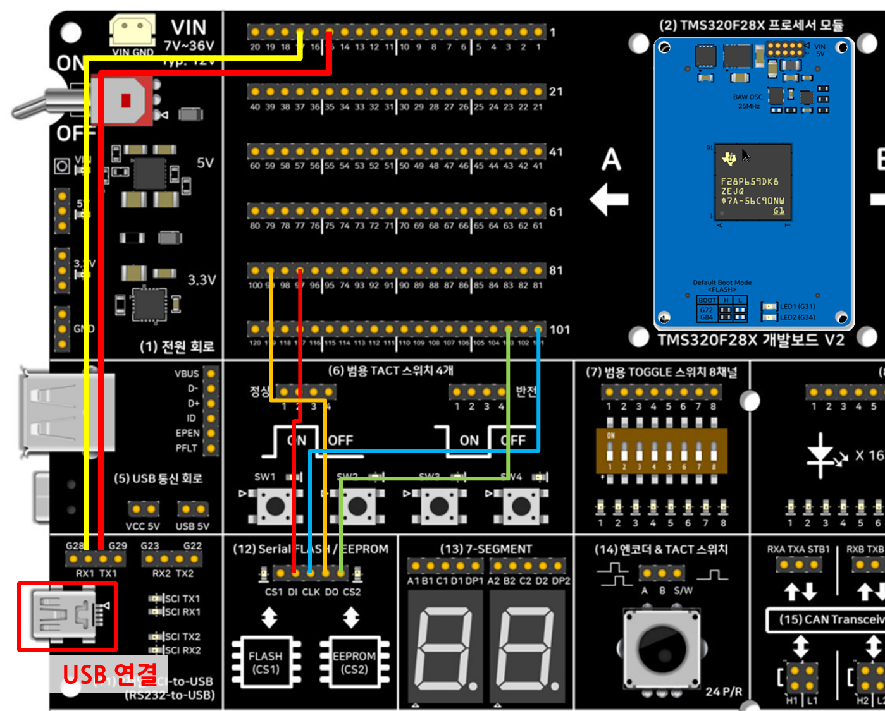

# 시리얼 EEPROM (M95M04, SPI) 대화형 콘솔 — TMS320F28P65x 비트필드 버전

**요약**
- 개발보드 V2의 **(12) 시리얼 FLASH & EEPROM** 회로에서 **EEPROM(ST M95M04-DR, 4 Mbit = 512 KB)** 을 SPI-A로 읽고 쓰고 검증합니다. **(11) SCI-to-USB** 터미널에서 `status`, `read`, `write`, `fill`, `test` 명령으로 조작합니다.
- **DriverLib을 전혀 쓰지 않고** 레지스터 구조체(`SpiaRegs`, `SciaRegs`, `GpioDataRegs`)를 직접 조작합니다. EEPROM 프로토콜(`m95m04.c`)과 명령어 쉘(`eeprom_cmds.c`)은 [DriverLib 버전](../12_Serial_EEPROM_Driverlib/)과 같은 파일입니다.
- 명령어 사용법, 출력 예, 문제 해결, 호스트 테스트는 DriverLib 버전 README에 자세히 있습니다.

## 1. 하드웨어 배선

### 1.1 (12) 회로 핀-헤더 CN9412 ↔ F28P65x 모듈 (A-Side CN9000)

EEPROM은 **CS2**를 씁니다. 시리얼 FLASH(M25P40)와 DI/CLK/DO를 공유하지만 CS1을 연결하지 않으면 보드 풀업으로 FLASH가 비선택 상태입니다.

| (12) 헤더 핀 | 신호 | F28P65x 모듈 핀 (A-Side) | GPIO | 레지스터 설정 |
|---|---|---|---|---|
| **DI** | MOSI | **A-Side 97번** | GPIO16 | MUX 1 (SPIA_PICO) |
| **DO** | MISO | **A-Side 99번** | GPIO17 | MUX 1 (SPIA_POCI) |
| **CLK** | SPICLK | **A-Side 101번** | GPIO18 | MUX 1 (SPIA_CLK) |
| **CS2** | EEPROM 칩 선택 | **A-Side 103번** | GPIO19 | 일반 GPIO 출력(Low 활성, `GPASET/GPACLEAR`) |
| CS1 | FLASH 칩 선택 | 연결하지 않음 | — | — |

이 SPI 핀(GPIO16~19)은 같은 핀을 쓰는 다른 SPI 예제와 겹칠 수 있으니 동시에 연결하지 마세요.

### 1.2 (11) SCI-to-USB ↔ F28P65x 모듈 (A-Side CN9000)

| (11) 핀 | 방향 | F28P65x 모듈 핀 (A-Side) | GPIO |
|---|---|---|---|
| **RX1** | PC → DSP | **A-Side 17번** | GPIO43 (SCIA_RX) |
| **TX1** | DSP → PC | **A-Side 15번** | GPIO42 (SCIA_TX) |

[11_SCI_to_USB 예제](../11_SCI_to_USB_Bitfield/)와 같은 핀이라 점퍼선을 옮기지 않아도 됩니다. GPIO42/43은 USB0DM/DP와 같은 핀이라 코드에서 아날로그 모드(`GPBAMSEL`)를 끄며, 5번 USB 예제와 동시에 쓸 수 없습니다.

터미널은 **115200 8N1, 흐름 제어 없음**.

### 1.3 연결도

| 선 색 | 모듈 핀 (A-Side) | 연결 대상 |
|---|---|---|
| 노랑 | 17번 (GPIO43, SCIA_RX) | (11) **RX1** |
| 빨강 (맨 위 줄에서 출발) | 15번 (GPIO42, SCIA_TX) | (11) **TX1** |
| 빨강 (아래쪽 줄에서 출발) | 97번 (GPIO16, SPIA_PICO) | (12) **DI** |
| 파랑 | 101번 (GPIO18, SPIA_CLK) | (12) **CLK** |
| 주황 | 99번 (GPIO17, SPIA_POCI) | (12) **DO** |
| 초록 | 103번 (GPIO19, CS2) | (12) **CS2** |

- 점퍼선은 6개이고, 빨간 선이 두 개이니 출발하는 핀 번호로 구분하세요. CS1은 연결하지 않습니다.
- 그림의 빨간 박스는 (11) 회로의 Mini-B USB 커넥터입니다. 여기를 PC에 연결하면 가상 COM 포트가 생기고, 이 포트로 콘솔을 씁니다.
- (11) 헤더 위의 `G28 G29` 같은 실크 표기와 상관없이, 이 예제는 점퍼선으로 A-Side 15번/17번(GPIO42/43)에 직접 연결하므로 위 표를 따르세요.
- 이 연결도는 DriverLib, 비트필드, FreeRTOS 세 버전에서 같습니다.

## 2. 명령어

| 명령 | 설명 | 예 |
|---|---|---|
| `help` | 명령어 목록 | `help` |
| `status` | 상태 레지스터와 블록 보호 상태 | `status` |
| `read <주소> [길이]` | hex + ASCII 덤프(기본 64바이트, 최대 1024) | `read 0x1f0 48` |
| `write <주소> <문자열>` | 쓰고 읽어서 검증 | `write 0x100 hello` |
| `fill <주소> <길이> <값>` | 범위를 한 바이트 값으로 채우고 검증 | `fill 0 512 0xff` |
| `test <주소> <길이>` | 패턴 쓰기 → 읽기 → 비교(범위를 덮어씀) | `test 0x1ff 100` |

주소·길이·값은 10진수 또는 `0x` 16진수, 칩 범위는 `0x00000`~`0x7FFFF`입니다.

## 3. 소프트웨어 구조

| 파일 | 역할 |
|---|---|
| `12_Serial_EEPROM_Bitfield.c` | 메인(`InitSysCtrl`, PIE 초기화, SCI-A 콘솔) |
| `m95m04_hal.c` | **SPI-A 비트필드 HAL**: 8비트, 표준 SPI 모드 0(`CLKPOLARITY=0`, `CLK_PHASE=1`), `SPIBRR=9`(5 MHz), FIFO 미사용·`SPISTS.INT_FLAG` 폴링, CS2는 GPIO19 |
| `m95m04.c` / `.h`, `eeprom_cmds.c` / `.h` | EEPROM 프로토콜과 명령어 쉘(세 버전 공통) |
| `utils/uartstdio.c` | SCI-A 비트필드 콘솔(FIFO 폴링). `ustdlib.c`는 DriverLib 의존(`debug.h`)을 제거한 버전 |
| `device/`, `f28p65x_headers_nonBIOS_cpu1.cmd` | TI 비트필드 헤더/초기화 소스(`11_SCI_to_USB_Bitfield`와 같은 구성) |

- 송신 버퍼(`SPITXBUF`)는 좌측 정렬(`<<8`), 수신 버퍼(`SPIRXBUF`)는 우측 정렬(`& 0xFF`)입니다.
- 이 예제는 인터럽트를 쓰지 않습니다. 쓰기 완료 대기(최대 5 ms)는 100 µs 단위 지연 루프입니다.
- 링커: RAM 구성은 `.text`를 RAMD0→LS0~3에, `.stack`을 RAMD1에 둡니다.

## 4. 빌드·실행

1. CCS에서 `File > Import > CCS Projects`로 이 폴더의 `CCS/`를 지정해 `12_Serial_EEPROM_Bitfield`를 가져옵니다.
2. 구성 선택: **CPU1_RAM** 또는 **CPU1_FLASH**.
3. Build → Debug → Run, 터미널에서 `help`를 입력합니다.

### 실행 화면 (시리얼 콘솔)

- 배너 다음 줄 `EEPROM answered, status register = 0x00`은 EEPROM이 응답했다는 뜻입니다. `0xFF`이거나 경고가 나오면 배선을 확인하세요.
- `read 0`은 0번지부터 64바이트를 16바이트씩 hex와 ASCII로 보여 줍니다. ASCII 열에는 출력 가능한 글자(0x20~0x7E)만 나오고 나머지는 `.`입니다. 첫 줄의 `74 74 70 6d`는 이전에 써 둔 글자(`ttpm`)이고, `fc fb fa …`로 이어지는 값은 이전 테스트 패턴이 남아 있는 것입니다.
- `write 0 test`는 4바이트를 쓰고 바로 읽어서 검증합니다(`verify OK`). 다시 `read 0`을 하면 `74 65 73 74`, 즉 `test`로 바뀌어 있습니다.
- COM 번호(그림은 COM35)는 PC마다 다릅니다. 터미널 설정은 115200 8N1입니다. CCS의 Serial Console 설정은 [11_SCI_to_USB 예제](../11_SCI_to_USB_Bitfield/)를 참고하세요.
- 이 화면은 FreeRTOS 버전에서 캡처한 것입니다. 이 버전의 배너는 `Bitfield version`으로 나오고, 명령 출력은 같은 `eeprom_cmds.c`가 만들어 같습니다.

## 5. 검증 상태

- **확인함(2026-10-06, 수정 후 2026-10-13 다시 확인)**: CCS 임포트·빌드를 흉내 낸 빌드로 **CPU1_RAM, CPU1_FLASH 모두 경고 없이 링크**. 공유 파일 4개가 DriverLib/FreeRTOS 버전과 바이트 단위로 같음을 확인했고, 그 파일들의 PC 호스트 테스트(프로토콜 13개, 쉘 14개)는 DriverLib 버전 폴더에서 통과합니다.
- **보드 확인함(2026-10-13)**: SCI 콘솔(GPIO42/43, 115200 8N1), EEPROM 응답(`status register = 0x00`), `write`→`read` 검증, ASCII 덤프.
- **확인 전**: `help`(정렬 수정 후), `status`, `fill`, `test` 명령과 블록 보호 동작. 비트필드 HAL의 SPI 레지스터 설정과 핀 먹스(SPI는 MUX 1, SCI는 GPIO42/43의 GMUX=3·MUX=3)는 DriverLib 핀 맵과 TI 헤더로 대조했습니다.

## 6. 세 버전 비교

| 버전 | 폴더 | 핵심 차이 | RAM 구성 사용량 | FLASH 구성 사용량 |
|---|---|---|---|---|
| DriverLib | [12_Serial_EEPROM_Driverlib](../12_Serial_EEPROM_Driverlib/) | TI 표준 HAL 함수 | 12,833 워드 | Flash 11,210 / RAM 2,369 |
| **비트필드(이 폴더)** | 12_Serial_EEPROM_Bitfield | 레지스터 직접 조작, DriverLib 없음 | 11,248 워드 | Flash 9,626 / RAM 2,167 |
| FreeRTOS | [12_Serial_EEPROM_Freertos](../12_Serial_EEPROM_Freertos/) | 태스크 2개, 쓰기 대기 중 CPU 양보, `uptime` | 16,252 워드 | Flash 13,862 / RAM 3,138 |

링크 맵의 영역별 사용량 합계(워드, 2026-10-13 CGT 25.11.1.LTS로 측정)입니다. RAM 구성은 코드까지 RAM에 올라가므로 크고, 스택(0x600)이 포함됩니다.
